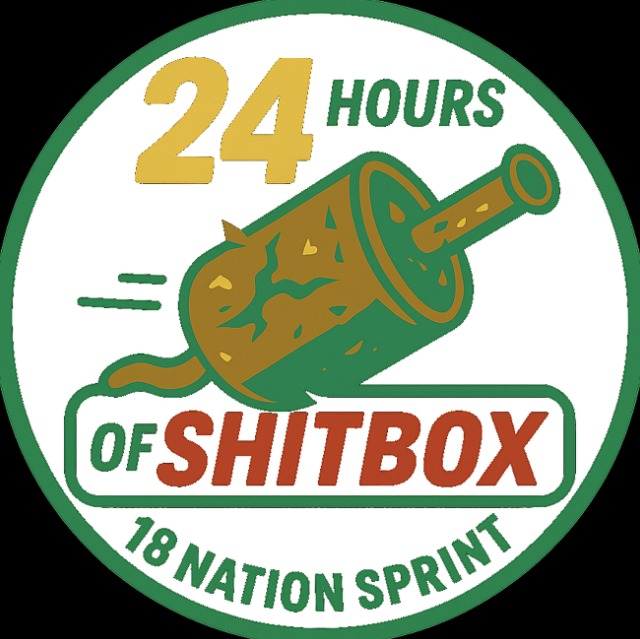
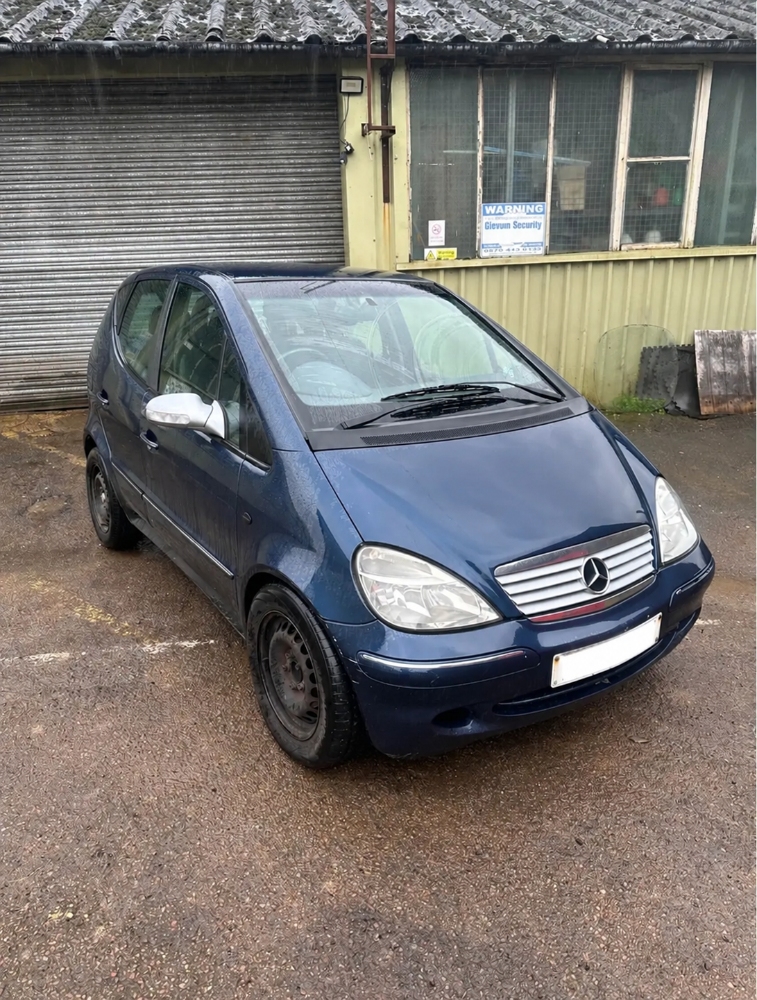

+++
date = '2026-10-26T19:37:15+00:00'
draft = true
title = '24 hours of Shitbox - 18 nation sprint'
weight = 20
showTableOfContents = true
+++

| Event Details |  |
|-----|----------|
| Date | Saturday 24th to Sunday 25th October 2026 |
| Venue | Mainland Europe |
|Organisers | [Shitbox Adventures](https://www.shitboxadventures.world/) |
|Team members | Adrian Schmieder, David Sutherland, Sam Parker |
|Results: | 3rd team to finish, taking 28hrs 13min to complete the challenge |

# The build up and preparations
Mid January 2026 sees David and Sam sat at the pub, chatting away with a cheeky opportunity of enjoying a few drinks on a Saturday afternoon while the family and wives were occupied...  Some nonsense chatting later, and Adrian had been roped into committing to driving through 18 countries in Europe, within 24 hours (or at least attempting to do so).  One catch, the car has to be a "shitbox".  

A number of car options were discussed until a 2003 Mercedes A Class was settled on and bought for an astonishing price of £150 though the car clearly needed some work to get it MOT and challenge ready.  A spring and summer of car repairs and preparations ensued (including David's daughters getting involved in a new paint job) and finally the car was ready for the upcoming challenge.  

# Getting to the start

A short bit about getting to the event in the first place, not much to cover here.

# Raceday

## Stint 1 - The Initial Chaos
Adrian start

## Stint 2 - Getting into the stride
Sam first stint

## Stint 3 - Boarders, boarders and more boarders
David overnight and boarder crossings

I drew the short straw with the night shift, taking us from Hungary through Romania, Serbia, Croatia and into Bosnia. Six hours of bleak weather, relentless rain and windscreen wipers that seemed more interested in screeching and smearing water around than actually removing it. Visibility was somewhere between questionable and completely hopeless. Adrian joined me on point duty, keeping us heading in roughly the right direction, while Sam took on the equally demanding responsibility of sleeping through most of it.

Things got interesting at the Serbian–Croatian border when the Germans in the BMW estate, first through, apparently tested positive for drugs. This triggered a full search and inspection of every car, costing us valuable time. We also managed a bit of roadside charity work, helping bump-start a VW van with a dead battery at the Serbian border. Expecting another interrogation entering and leaving Bosnia, we were pleasantly surprised to be waved straight through as harmless tourists. Six hours, five countries, atrocious weather, international border drama and one sleeping passenger. Just another relaxing evening in Cheesy!

## Stint 4 - Motorways in the mist
Adrian overnight motorway schleps

## Stint 5 - The Italian Alps
Sam through the Alps

## Stint 6 - We've had enough of these mountains
David write up

After surviving the previous night's misery, I was rewarded with arguably the best driving stint of the challenge. Austria, Switzerland, Liechtenstein and back into Switzerland, finishing in Zurich. Glorious Alpine scenery, sweeping mountain roads, brilliant tunnels and finally some daylight! Fuelled by a can of Monster, a bag of Haribo and a wildly misplaced belief that cheesy was a genuine racing car, I was thoroughly enjoying myself. Adrian was back on point duty while Sam attempted to catch up on sleep, although my enthusiasm for the Austrian roads made that somewhat challenging. The only real confrontation came courtesy of an impatient BMW driver who repeatedly tried to blind me with his headlights in a heavily speed-camera-controlled tunnel. An admittedly ill-advised brake check got the message across, and provided an adrenaline hit considerably stronger than the Monster.

With the leading two teams still ahead, our strategy shifted towards maximising time between fuel stops. Unfortunately, Adrian's navigation skills briefly deserted him when he directed us to a fuel station that appeared to be missing one crucial feature: an actual fuel station. With the gauge firmly on zero and our hopes of finishing evaporating, we limped to another garage and brimmed the tank, giving us just enough fuel to reach the finish. Four and a half hours of Alpine roads, questionable overtaking etiquette, fuel-range roulette and enough sugar and caffeine to restart a small power station. Easily my favourite stint of the challenge!

## Stint 7 - French Autoroutes
Adrian daytime motorway route

## Stint 8 - The final dash and a chance of UK 1-2 finish
Sam final stint write up.

# Getting home
Some stuff about the journey home.
