+++
date = '2026-10-26T19:37:15+00:00'
draft = true
title = '24 hours of Shitbox - 18 nation sprint'
weight = 20
showTableOfContents = true
+++

| Event Details |  |
|-----|----------|
| Date | Saturday 24th to Sunday 25th October 2026 |
| Venue | Mainland Europe |
|Organisers | [Shitbox Adventures](https://www.shitboxadventures.world/) |
|Team members | Adrian Schmieder, David Sutherland, Sam Parker |
|Results: | 3rd team to finish, taking 28hrs 13min to complete the challenge |

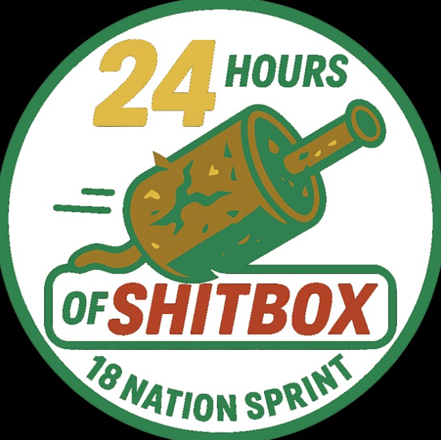

# The build up and preparations
Mid January 2026 sees David and Sam sat at the pub, chatting away with a cheeky opportunity of enjoying a few drinks on a Saturday afternoon while the family and wives were occupied...  Some nonsense chatting later, and Adrian had been roped into committing to driving through 18 countries in Europe, within 24 hours (or at least attempting to do so).  One catch, the car has to be a "shitbox".  

SHITBOX -> <u>S</u>upporting <u>H</u>opeful <u>I</u>nnovations <u>T</u>hrough <u>B</u>reakdowns, <u>O</u>il and <u>Xt</u>ra tape

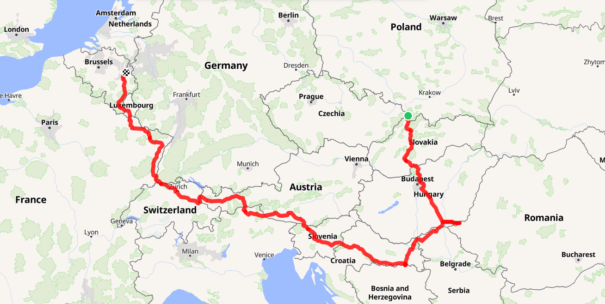

A number of car options were discussed until a 2003 Mercedes A Class was settled on and bought for an astonishing price of £150 though the car clearly needed some work to get it MOT and challenge ready.  A spring and summer of car repairs and preparations ensued (including David's daughters getting involved in a new paint job) and finally the car was ready for the upcoming challenge.  

# Getting to the start

Setting off from Bristol on Wednesday evening, after work, the team headed down to Kent for the first long leg the car had completed after its MOT and being fully laden with the lads and kit.  No dramas were had and a few celebratory beers were consumed.

Thursday and Friday saw the team driving through all of Germany and Czechia to the rendez-vous point at [Horska chata Skalka](https://www.google.com/travel/hotels/s/mFMVEZNkuX5eyQpp8).  Many drinks, some good local food and after lots of chattering with other teams the team hit the pit to get a good night's rest before the long challenge ahead.

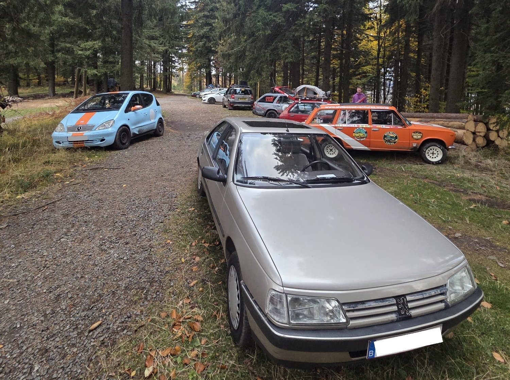

# Challenge day

## Getting to Country #1
The challenge was to start at 1300h local time just inside the Polish border.  Unfortuantely the event suffered its first casualty before the start line, with a well kitted-out Volvo hitting a rock coming down the mountain roads, cracking the oil sump.  Thankfully the stop at the local supermarket showed that at least some oil was left in the engine at that point, but the rate it was bleeding out (and making a mess of the place) ended the team's attempt at the challenge.  

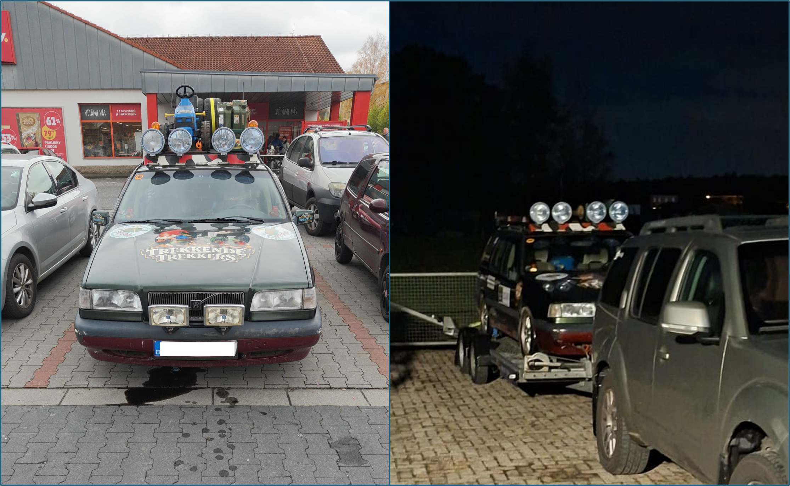

A phonecall back to the family in Belgium and a trailer was dispatched for recovery, with the Volvo getting home around 30 hours later.  A shame the team couldn't join the fun, but we're sure to see them again at a future event.

All other teams made it to the start car park and chilled out, messing around to get some photos and chatting.  Final navigational preparations were made with new GPX tracking apps downloaded.

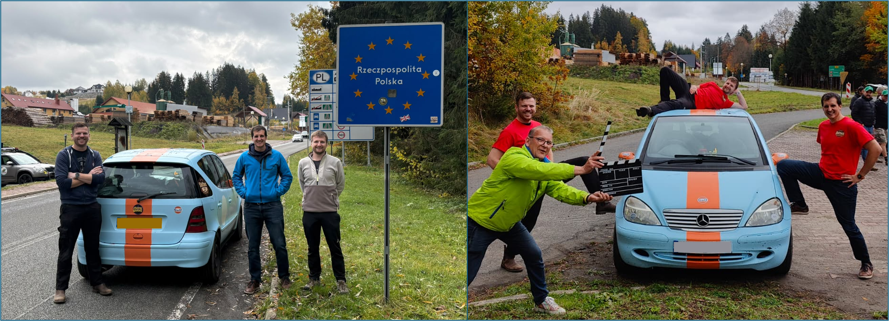

## Stint 1 - The Initial Chaos

| Stint Details |  |
|-----|----------|
| Start |2026-10-24 1300h |
| End | 2026-10-24 1600h |
| Driver | Adrian |
| Countries Visited | Poland, Czechia, Slovakia |

1300h arrives and we're off!!!  Until 2 minutes down the road, back into Czechia and a Police checkpoint stops the lead car and asks for documentation.  Thankfully the lead car seemed to keep the Police happy, and they allowed the convoy to continue.  

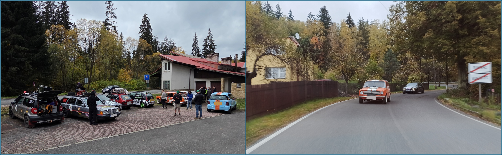

What then ensued for the PTR team, is an hour of carnage.  It turns out the apps that had been freshly downloaded to keep a track of navigation didn't really work that well.  Adrian was trying to keep to whatever navigational route was being provided by one phone, while also trying to keep an eye on what the other cars were doing...

 > They've gone that way... should we follow???
 
 > Yeah, it's the event organiser... They must know what they're doing...

> Another team's gone that other way...

> Leave them to it, follow the organiser...

> Google's suggesting 3 routes, which should we take?

> Stick to the route we've got already mapped in... I'm sure it'll work itself out...

Some rapid ChatGPT deployment later, and we had a defined Google Maps plan.  Great for keeping us on the most efficient route whilst taking realtime traffic conditions into consideration.

During all of this, a message comes through from the organisers:
>We've lost clutch...  When we stop at traffic lights, we're having to restart the car in gear, and then we're working through clutch-less gear changes!!! Has anyone got any break / clutch fluid at all?

Somehow we'd found ourselves at the front of the pack, and with a half bottle of break fluid in the boot we were able to stop in at a small side road.  A quick exchange and we were back underway.  Still, somehow, in the lead, and having allowed the organisers to top up and re-bleed their clutch system and continue with minimal delay.

A while later and the question gets asked:
> How are the other teams getting on?  Are we still leading the pack? How far behind is everyone?

And an interesting answer is given:

> Well... we can't tell...  
Most of the other teams are on the same route as us.  
The other British team has gone a subtly different route, they are possibly ahead, but it looks as if it's a longer way round.  
The Germans seem to have gone a totally different direction, and we're not even sure how they can recover this... They're going East to Bratislava and we can't make sense of it.

Well let's carry on with our own adventure... We're 2 hours into a 24hr slog... who knows what might happen.  

20min down the road, we get overtaken on a motorway by the Swiss team (what a sight) only for them to have to dip into a fuel station to fill up.  Another 20min down the road, and that's the first stint concluded on the pre-planned 3hr mark.  A quick roadside rotation, and Sam takes the reigns.

## Stint 2 - Getting into the stride

| Stint Details |  |
|-----|----------|
| Start |2026-10-24 1600h |
| End | 2026-10-24 1915h |
| Driver | Sam |
| Countries Visited | Slovakia, Hungary |

Sam first stint

## Stint 3 - Boarders, boarders and more boarders

| Stint Details |  |
|-----|----------|
| Start |2026-10-24 1915h |
| End | 2026-10-25 0045h |
| Driver | David |
| Countries Visited | Hungary, Romania, Hungary, Serbia, Croatia, Bosnia and Herzegovina, Croatia |

A write up from David: 

I drew the short straw with the night shift, taking us from Hungary through Romania, Serbia, Croatia and into Bosnia. Six hours of bleak weather, relentless rain and windscreen wipers that seemed more interested in screeching and smearing water around than actually removing it. Visibility was somewhere between questionable and completely hopeless. Adrian joined me on point duty, keeping us heading in roughly the right direction, while Sam took on the equally demanding responsibility of sleeping through most of it.

Things got interesting at the Serbian–Croatian border when the Germans in the BMW estate, first through, apparently tested positive for drugs. This triggered a full search and inspection of every car, costing us valuable time. We also managed a bit of roadside charity work, helping bump-start a VW van with a dead battery at the Serbian border. Expecting another interrogation entering and leaving Bosnia, we were pleasantly surprised to be waved straight through as harmless tourists. Six hours, five countries, atrocious weather, international border drama and one sleeping passenger. Just another relaxing evening in Cheesy!

## Stint 4 - Motorways in the mist

| Stint Details |  |
|-----|----------|
| Start |2026-10-25 0045h |
| End | 2026-10-25 0215h, daylight savings change |
| Driver | Adrian |
| Countries Visited | Croatia, Slovenia |

Just back on the Croatian side of the Bosnia and Herzegovina boarder and I take on the next stint.  The route from here is a tiny bit of North to get the the motorway and then on this one road West all the way through Croatia and then continuing on through Slovenia.  It's the dead of night, rain's coming down hard, our wipers really aren't the best... let's settle in for a motorway slog...

A quick check on other teams' locations, and we see the event organisers (who were ahead of us) are coming down South towards us???  Where have they been?  Have we somehow overtaken them?  Have they taken a wrong turning?  Oh wait...  We're at the motorway junction... which exit do we need?  This side of the barrier, or that side???  It's this side; no it's that side...  I'm going this way...  Ohhh... good call, that seems to be taking us the correct way...

Ahhh... that's what the guys ahead of us did... what a confusing junction, and in these conditions, we only just avoiding going wrong ourselves!!

Croatia... what's there to say?  Cheesy wasn't liking the slow lane of that whole motorway.  Every single small undulation seemed to unsetle the car and induce a sideways jump.  Sitting in the overtaking lane the whole time avoided this concern.

> I think we've made it into Slovenia

At the boarder, the long straight motorway suddenly gets bendy... and foggy!!!  Trying to maintain decent progress, fog lights dismally attempting to illuminate at least some of the road ahead... let's slow down a bit and avoid falling off the road.  

~3hrs of motorway after the stint started and a fuel stop was found.  We're about to head through the Austrian and Italian Alps, at silly-o'clock in the morning...  let's not run out of fuel there.  Here you go Sam... have fun on some small roads... I need some sleep!!

## Stint 5 - The Italian Alps

| Stint Details |  |
|-----|----------|
| Start | 2026-10-25 0215h |
| End | 2026-10-25 0530h |
| Driver | Sam |
| Countries Visited | Slovenia, Austria, Italy |

Sam through the Alps

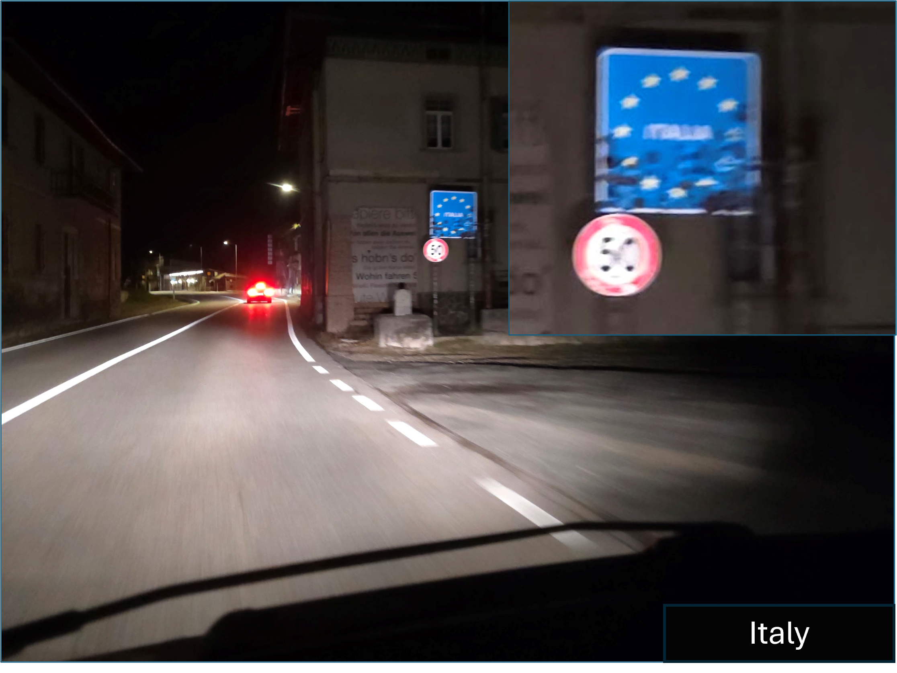

## Stint 6 - Aren't these mountains stunning!!

| Stint Details |  |
|-----|----------|
| Start | 2026-10-25 0530h |
| End | 2026-10-25 1000h |
| Driver | David |
| Countries Visited | Italy, Austria, Liechtenstein, Switzerland |

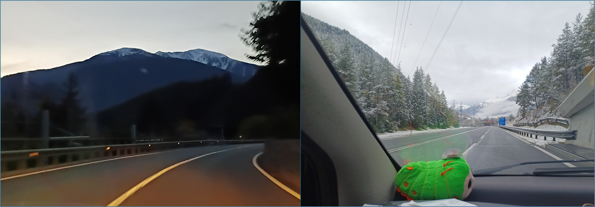

After surviving the previous night's misery, I was rewarded with arguably the best driving stint of the challenge. Italy, Austria, Switzerland, Liechtenstein and back into Switzerland, finishing in just outside Basel. Glorious Alpine scenery, sweeping mountain roads, brilliant tunnels and finally some daylight! Fuelled by a can of Monster, a bag of Haribo and a wildly misplaced belief that cheesy was a genuine racing car, I was thoroughly enjoying myself. Adrian was back on point duty while Sam attempted to catch up on sleep, although my enthusiasm for the Austrian roads made that somewhat challenging. The only real confrontation came courtesy of an impatient BMW driver who repeatedly tried to blind me with his headlights in a heavily speed-camera-controlled tunnel. An admittedly ill-advised brake check got the message across, and provided an adrenaline hit considerably stronger than the Monster.

With the leading two teams still ahead, our strategy shifted towards maximising time between fuel stops. Unfortunately, Adrian's navigation skills briefly deserted him when he directed us to a fuel station that appeared to be missing one crucial feature: an actual fuel station. With the gauge firmly on zero and our hopes of finishing evaporating, we limped to another garage and brimmed the tank, giving us just enough fuel to reach the finish. Four and a half hours of Alpine roads, questionable overtaking etiquette, fuel-range roulette and enough sugar and caffeine to restart a small power station. Easily my favourite stint of the challenge!

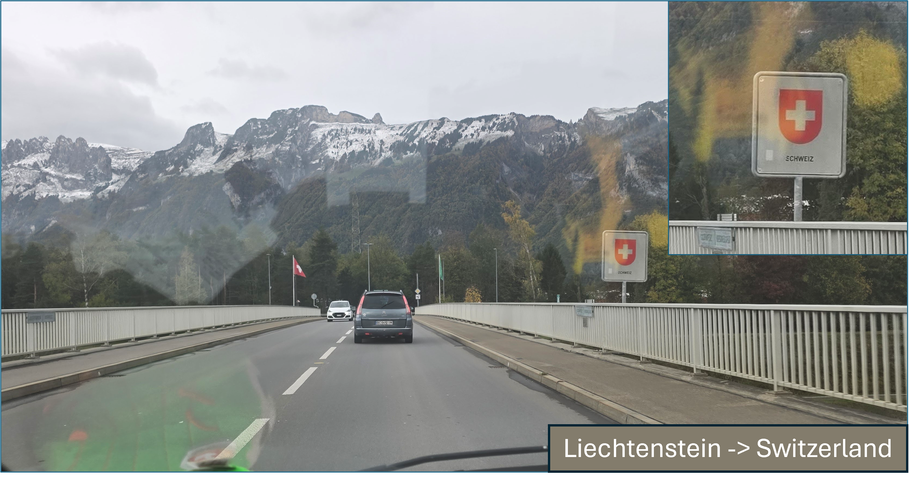

## Stint 7 - French Autoroutes

| Stint Details |  |
|-----|----------|
| Start | 2026-10-25 1000h |
| End | 2026-10-25 1200h |
| Driver | Adrian |
| Countries Visited | Switzerland, Germany, France |

Feeling relieved that my incorrect assumption that a "Rest Stop" included a fuel station hadn't caused us a significant delay, we were off again, with an absolutely brimmed tank of fuel.  Straight through the German boarder and on an autobahn around Basel I remembered our next Google Maps checkpoint is back in Basel city.  This is just at the junction of Switzerland, Germany and France, and was placed such that we could just touch into Germany and be straight into France...  But hold on, we're already in Germany and have the country ticked off...  It's now a Sunday morning and I feel we're about to get swamped into city traffic if we get to that checkpoint.  

A bit of searching around by the other guys, and it was confirmed we can simply continue north from Basel, then cross into France East of Mulhouse.  From there continue North to Strasbourg and then cut North-West to Metz.  

Another motorway slog, and the weather really wasn't much better than my last stint, except this time it's daylight with increased side-winds from storm Austen, and now there's other traffic on the roads.  Having been up and alert since 0530h, the fatigue was setting in and after only a short stint of around 2hrs driving, it suddenly felt unsafe to be driving and the reigns were handed over early for Sam's, and the challenge's (hopefully), last driver stint.

## Stint 8 - The final dash and a chance of UK 1-2 finish

| Stint Details |  |
|-----|----------|
| Start | 2026-10-25 1200h |
| End | 2026-10-25 1513h |
| Driver | Sam |
| Countries Visited | France, Luxembourg, Belgium, Netherlands |

Sam final stint write up.

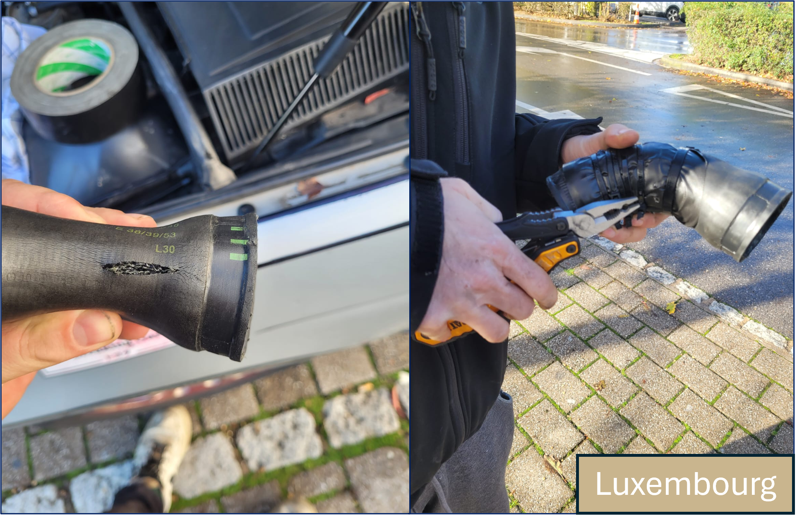

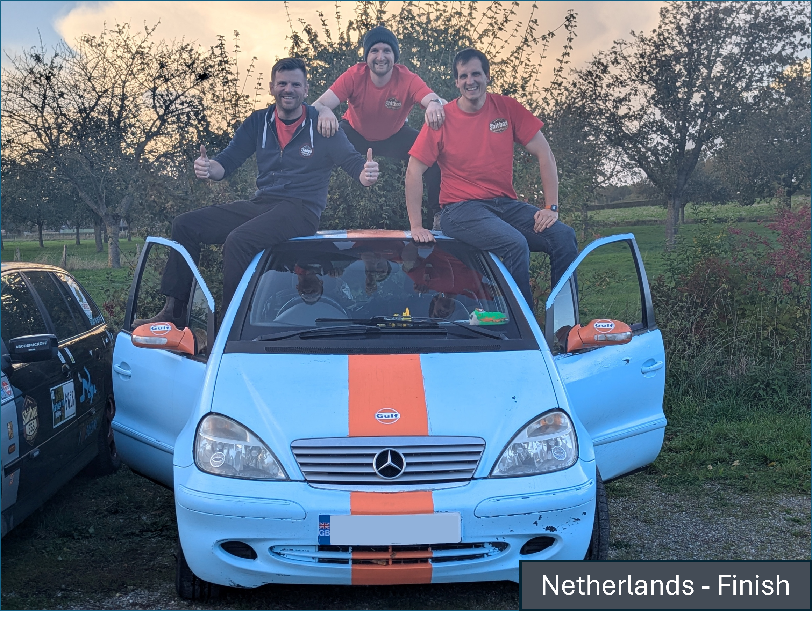

# Getting home
After good food, some good Belgian beer and a good night's sleep in Liège the team was up early for the journey home.  Only a short 3hr stint later and the team was doing a bit of booze-cruise shopping before getting on the train back to the UK.  

A further short 4hr stint and the team was back at base unloading the car before small jaunt to Bristol, where the car is to be wrapped up warm, given a rest and put up for sale for another adventure at another home.  A great time was had, a break away from the office, and potentially a world-record set!!!  Thanks again [Shitbox Adventures](https://www.shitboxadventures.world/) for organising a unique experience, and until the next time, when we'll be sure to be bringing the British to the party!!


